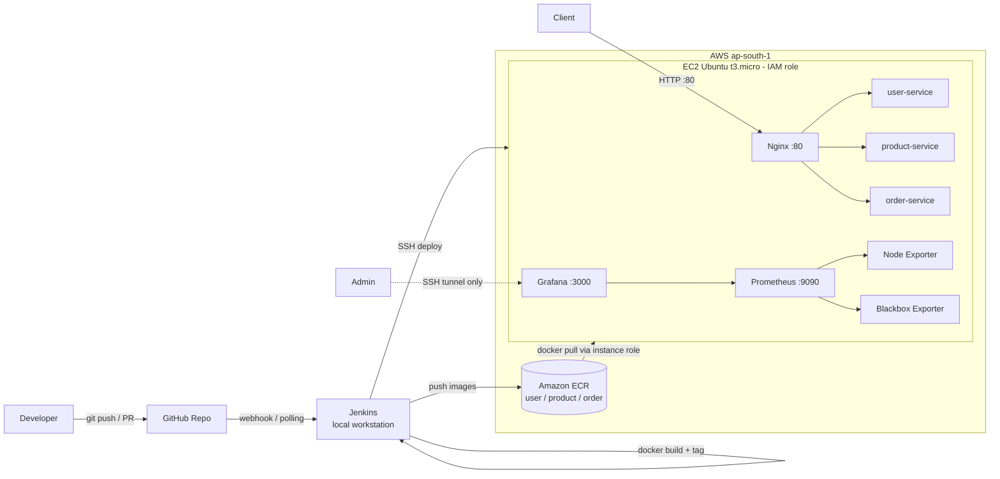

Microservices CI/CD on AWS (GitHub, Jenkins, Docker, Terraform, ECR, Prometheus, Grafana)
A repeatable DevOps delivery process that builds, ships, deploys and monitors three existing microservices (User, Product, Order) on a single AWS EC2 instance.
> Scope: DevOps only. The application code was supplied and not modified.
---
1. Architecture

Key design choices
Area	Choice
Infrastructure	Terraform: 1 EC2, 3 ECR repos, security group, IAM role + instance profile
Orchestration	Docker Compose (no Kubernetes, RDS, NAT or load balancer)
Routing	Nginx reverse proxy on port 80
CI/CD	Jenkins on a local workstation, `Jenkinsfile` in the repo
Auth to ECR	EC2 uses an IAM role; Jenkins uses stored Jenkins credentials (no hardcoded keys)
Monitoring	Prometheus + Node Exporter + Blackbox Exporter + Grafana
Access	SSH restricted to my IP; Grafana/Prometheus reached only through an SSH tunnel
---
2. Repository structure
> Adjust this block to match your actual folders.
```
microservices-devops/
├── user-service/            # Dockerfile + source
├── product-service/
├── order-service/
├── nginx/                   # nginx.conf
├── docker-compose.yml       # local run
├── docker-compose.ec2.yml   # EC2 deployment (uses ECR images)
├── jenkins/
│   └── Jenkinsfile
├── terraform/
│   ├── main.tf
│   ├── variables.tf
│   ├── outputs.tf
│   └── terraform.tfvars.example
├── monitoring/
│   ├── docker-compose.yml
│   └── prometheus.yml
├── docs/                    # screenshots, plan/destroy output, notes
└── README.md
```
---
3. Prerequisites
Local machine (WSL / Linux)
Git, Docker Engine, Docker Compose
Terraform >= 1.5
AWS CLI v2, configured with an IAM user that can create EC2, ECR and IAM resources
An EC2 key pair (`microservices-key`) with the `.pem` stored outside the repo (`chmod 400`)
Jenkins server (workstation)
Jenkins with plugins: Git, Pipeline, Credentials Binding, AWS Credentials, SSH Agent
Docker and AWS CLI available to the Jenkins agent
Credentials added in Jenkins:
`aws-creds` (type: AWS Credentials)
`ec2-ssh` (type: SSH Username with private key)
AWS
Region: `ap-south-1`
Budget alert configured before provisioning
---
4. Security practices
`.gitignore` excludes `*.pem`, `*.tfstate*`, `.terraform/`, `.env`, `terraform.tfvars`
No AWS keys or passwords in code; Jenkins credentials + EC2 IAM role are used
Security group inbound: SSH (22) from my IP only, HTTP (80) from the internet; Jenkins, Prometheus and Grafana are not exposed publicly
IAM role on EC2 grants only the ECR read/pull permissions it needs
---
5. Deployment steps
5.1 Provision infrastructure (Terraform)
```bash
cd terraform
cp terraform.tfvars.example terraform.tfvars   # set key name and your IP
terraform init
terraform validate
terraform plan -out=tfplan
terraform apply tfplan
terraform output                               # EC2 public IP, ECR URLs
```
Creates: 1 EC2 (Ubuntu, t3.micro, Docker/Compose/AWS CLI installed via cloud-init), 3 ECR repositories, security group, IAM role/profile.
5.2 Verify the EC2 host
```bash
ssh -i ~/.ssh/microservices-key.pem ubuntu@<EC2_PUBLIC_IP>
docker --version && docker compose version && aws --version
df -h && free -m
```
5.3 Build, tag and run locally (sanity check)
```bash
docker compose up -d --build
curl http://localhost/users/health
curl http://localhost/products/health
curl http://localhost/orders/health
```
5.4 Push images to ECR (manual first run)
```bash
aws ecr get-login-password --region ap-south-1 \
  | docker login --username AWS --password-stdin <ACCOUNT_ID>.dkr.ecr.ap-south-1.amazonaws.com

docker tag user-service:1.0.0 <ACCOUNT_ID>.dkr.ecr.ap-south-1.amazonaws.com/user-service:1.0.0
docker push <ACCOUNT_ID>.dkr.ecr.ap-south-1.amazonaws.com/user-service:1.0.0
# repeat for product-service and order-service
```
5.5 Deploy with the Jenkins pipeline
Create a Pipeline job (`microservices`) using Pipeline script from SCM, path `jenkins/Jenkinsfile`.
Add a GitHub webhook (or poll SCM) to trigger on push to `main`.
Pipeline stages:
Checkout: pull source from GitHub
Validate: validate compose/config files
Test: run available application tests
Build & Tag: build 3 images, tag with the build version
Push to ECR: authenticate with `aws-creds`, push versioned images
Deploy to EC2: SSH with `ec2-ssh`, set the image tag, `docker compose pull && up -d`
Health Check: verify Nginx routing and all `/health` endpoints
`post { failure { ... } }` prints logs and marks the build failed.
5.6 Start monitoring on EC2
```bash
cd ~/monitoring
docker compose up -d
```
Access from your workstation through an SSH tunnel (nothing is public):
```bash
ssh -i ~/.ssh/microservices-key.pem \
    -L 3000:localhost:3000 -L 9090:localhost:9090 \
    ubuntu@<EC2_PUBLIC_IP>
```
Grafana: http://localhost:3000 (data source: Prometheus)
Prometheus: http://localhost:9090 (targets: node, prometheus, 4 service probes)
Dashboards: Service Availability (`probe_success`) and Node Exporter Full (ID 1860) for CPU, memory and disk
5.7 Verify
```bash
curl http://<EC2_PUBLIC_IP>/users/health
curl http://<EC2_PUBLIC_IP>/products/health
curl http://<EC2_PUBLIC_IP>/orders/health
```
---
6. Release management and rollback
Versioning: every Jenkins build produces images tagged with the build version (for example `1.0.13`) in ECR. Older tags stay available.
Update: push a change to `main`, then Jenkins builds, tags, pushes and deploys the new version.
Rollback / recovery
```bash
ssh -i ~/.ssh/microservices-key.pem ubuntu@<EC2_PUBLIC_IP>
cd ~/app
# set IMAGE_TAG to the last known-good version (e.g. 1.0.12)
export IMAGE_TAG=1.0.12
docker compose -f docker-compose.ec2.yml pull
docker compose -f docker-compose.ec2.yml up -d
curl http://localhost/products/health
```
Rollback demonstrated: version `1.0.13` rolled back to `1.0.12` with all health endpoints returning OK.
---
7. Troubleshooting notes
7.1 Simulated failure drill
Step	Detail
Fault injected	`docker stop app-product-service-1`
Detection	Grafana Service Availability showed `/products/health` as DOWN; Prometheus probe `probe_success = 0`
Investigation	`docker ps -a`, `docker logs app-product-service-1`, `docker inspect`
Root cause	Container was stopped manually
Recovery	`docker compose -f docker-compose.ec2.yml up -d`
Verification	All 4 endpoints back UP in Grafana and via `curl`
7.2 Issues faced and fixes
Problem	Cause	Fix
`git push` failed: `src refspec main does not match any`	No commit existed yet / branch name mismatch	Commit first, then `git branch -M main`
Push rejected: `fetch first`	Remote already had commits	`git pull --rebase origin main`, then push
Nginx not reachable on port 80	Wrong port mapping `80:81` in `docker-compose.ec2.yml`	Changed to `80:80`
Jenkins ECR/SSH stage failures	Credential type / ID mismatch	Used `aws-creds` (AWS Credentials type) and `ec2-ssh` (SSH key)
7.3 Useful commands
```bash
docker ps -a
docker logs <container> --tail 100
docker compose -f docker-compose.ec2.yml ps
sudo journalctl -u docker --since "1 hour ago"
sudo tail -f /var/log/syslog
df -h; free -m; top
```
---
8. Cleanup
Destroy everything to avoid AWS charges:
```bash
cd terraform
terraform plan -destroy -out=destroy.tfplan
terraform destroy
```
Resources destroyed (8): EC2 instance, 3 ECR repositories, security group, IAM role, instance profile and policy attachment.
Afterwards:
Disable the Jenkins job so webhooks do not trigger deployments
Confirm in the AWS console that no EC2, ECR or Elastic IP resources remain
Keep the budget alert enabled
---
9. Evidence (see `docs/`)
Jenkins successful pipeline run
Terraform plan, apply and destroy output
ECR repositories with versioned images
Three services running on EC2 and Nginx routing
Prometheus targets and Grafana dashboards
Failure simulation and recovery
Rollback demonstration
