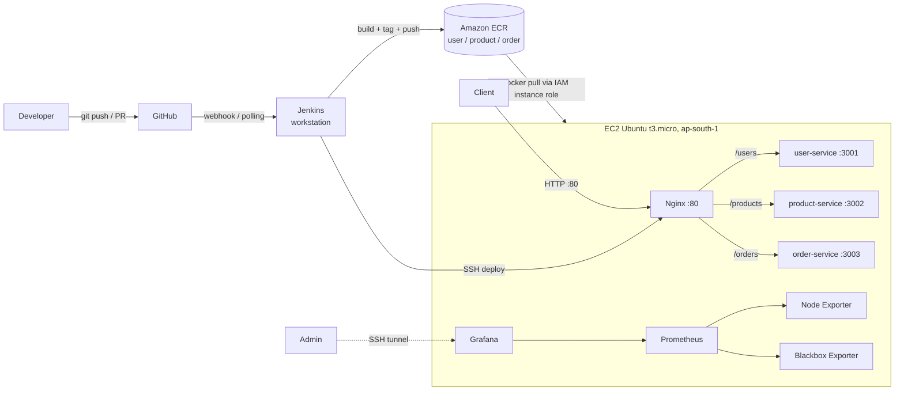
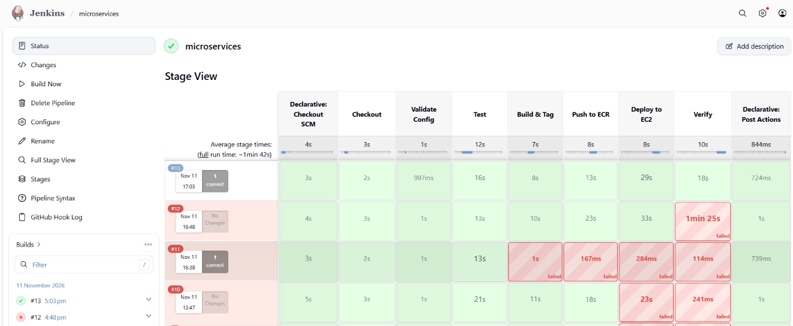

# Microservices CI/CD, AWS Deployment and Monitoring

End-to-end DevOps implementation for three existing microservices (User, Product, Order) using
GitHub, Jenkins, Docker, Docker Compose, Nginx, Terraform, Amazon ECR, AWS EC2, Prometheus and Grafana.

Repository: https://github.com/meyananth/microservices-devops

> Scope: DevOps only. The application code was supplied and not modified.

## 1. Architecture



Infrastructure (EC2, 3 ECR repositories, security group, IAM role and instance profile) is created with Terraform.

## 2. Repository structure

| Path | Purpose |
|------|---------|
| `services/` | The three microservices and their Dockerfiles |
| `nginx/` | Nginx reverse proxy configuration |
| `docker-compose.yml` | Local multi-container run |
| `docker-compose.ec2.yml` | Deployment file used on EC2 (images come from ECR via `REGISTRY` and `TAG`) |
| `jenkins/Jenkinsfile` | CI/CD pipeline |
| `terraform/` | AWS infrastructure as code |
| `monitoring/` | Prometheus config and monitoring compose file |
| `docs/` | Screenshots and evidence |

## 3. Prerequisites

- AWS account (region `ap-south-1`), AWS CLI configured on the workstation
- Terraform, Docker, Git
- Jenkins on the workstation with Docker access and these credentials:
  - `aws-creds` (AWS Credentials type)
  - `ec2-ssh` (SSH private key for the EC2 host)
- An EC2 key pair (`microservices-key`). The `.pem` file is never committed.

## 4. Security notes

- No secrets, keys or state files are committed: `*.pem`, `.env`, `*.tfstate`, `.terraform/` and `*.tfvars` are in `.gitignore`.
- EC2 pulls from ECR through an IAM instance role. No AWS keys are stored on the host.
- SSH (port 22) is limited to the administrator IP. Only port 80 is public.
- Prometheus (9090) and Grafana (3000) are bound to `127.0.0.1` on EC2 and reached through an SSH tunnel.
- Jenkins is not exposed publicly.

## 5. Provision infrastructure (Terraform)

```bash
cd terraform
terraform init
terraform validate
terraform plan -out=tfplan
terraform apply tfplan
terraform output
```

Resources created: 1 EC2 instance (t3.micro, Ubuntu, Docker, Docker Compose and AWS CLI installed by cloud-init),
3 ECR repositories, a security group and an IAM role with an instance profile for ECR pull access.
Variables and outputs make the configuration reusable. State stays local and is not committed.

## 6. Branch workflow

- `main`: stable, release-ready
- feature branches for changes, merged through pull requests
- Jenkins is triggered by a GitHub webhook (or SCM polling) on push

## 7. CI/CD pipeline (Jenkins)

Job `microservices` runs `jenkins/Jenkinsfile`. Stages:

1. **Checkout**: pull the repository from GitHub
2. **Validate**: configuration checks (compose and file validation)
3. **Test**: run available application tests
4. **Build & Tag**: build all three images and tag them with the build version
5. **Push to ECR**: authenticate with `aws-creds` and push versioned images
6. **Deploy to EC2**: create `~/app`, copy the compose file over SSH (`ec2-ssh`), then `docker compose pull` and `up -d` with the selected `TAG`
7. **Verify**: check the health endpoints through Nginx

On failure the pipeline stops, keeps the build log and reports the failed stage.



## 8. Deployment

On EC2 the application lives in `~/app`:

```bash
cd ~/app
cat .env                 # REGISTRY and TAG
docker compose up -d
docker ps
```

Verify routing and health:

```bash
curl -i http://<EC2_PUBLIC_IP>/health
curl -i http://<EC2_PUBLIC_IP>/users/health
curl -i http://<EC2_PUBLIC_IP>/products/health
curl -i http://<EC2_PUBLIC_IP>/orders/health
```

## 9. Rollback and recovery

Images are versioned in ECR, and the compose file reads the version from `TAG` in `.env`.

```bash
cd ~/app
sed -i 's/^TAG=.*/TAG=1.0.12/' .env     # known-good version
docker compose up -d
docker ps --format "table {{.Names}}\t{{.Image}}\t{{.Status}}"
curl -i http://localhost/products/health
```

To roll forward, set `TAG` back to the newer version (for example `1.0.13`) and run `docker compose up -d` again.
Demonstrated: build `1.0.13` rolled back to `1.0.12`, all services healthy.

## 10. Monitoring

On EC2 in `~/monitoring`:

- **Prometheus** scrapes itself, Node Exporter (host CPU, memory, disk) and Blackbox Exporter
- **Blackbox Exporter** probes `/health`, `/users/health`, `/products/health` and `/orders/health` through Nginx (`probe_success`)
- **Grafana** uses Prometheus as data source. Dashboards: Node Exporter Full (ID 1860) and Service Availability

Access over an SSH tunnel:

```bash
ssh -i <key>.pem -L 3000:localhost:3000 -L 9090:localhost:9090 ubuntu@<EC2_PUBLIC_IP>
```

Then open `http://localhost:3000` (Grafana) and `http://localhost:9090/targets` (Prometheus).

## 11. Troubleshooting drill

| Step | Detail |
|------|--------|
| Simulated failure | `docker stop app-product-service-1` |
| Symptom | Grafana Service Availability: `products/health` DOWN |
| Detection | Prometheus `probe_success = 0` for the products endpoint |
| Investigation | `docker ps -a` (container Exited), `docker logs app-product-service-1`, `curl -i http://localhost/products/health` |
| Root cause | Product container was stopped, so Nginx could not reach the upstream |
| Fix | `docker start app-product-service-1` (or `docker compose up -d`) |
| Verification | All 4 endpoints UP in Grafana, `/products/health` returns 200 |

Issues faced during the build and how they were fixed:

| Problem | Cause | Fix |
|---------|-------|-----|
| `git push` failed: `src refspec main does not match any` | No commit yet on `main` | Commit first, then push |
| Push rejected: `fetch first` | Remote already had commits | `git pull --rebase origin main`, then push |
| Nginx not reachable on port 80 | Wrong port mapping `80:81` in `docker-compose.ec2.yml` | Changed to `80:80` |
| Jenkins ECR/SSH stage failures | Credential type / ID mismatch | `aws-creds` (AWS Credentials type) and `ec2-ssh` (SSH key) |
| Deploy stage failed on `scp` | `~/app` did not exist on EC2 | Pipeline now creates `~/app` before copying |

Other useful checks: `docker logs <container>`, `journalctl -u docker`, `df -h`, `free -m`, `top`.

## 12. Evidence

Screenshots are stored in `docs/screenshots/`.

## 13. Cleanup

```bash
cd terraform
terraform destroy
```

`terraform destroy` was run after the demo and removed 8 resources: the EC2 instance, 3 ECR repositories,
the security group, and the IAM role, instance profile and policy attachment. The destroy plan is saved as evidence.

Afterwards:
- Disable the Jenkins job so webhooks do not trigger deployments
- Check the AWS console for leftover resources
- Keep a budget alert configured
